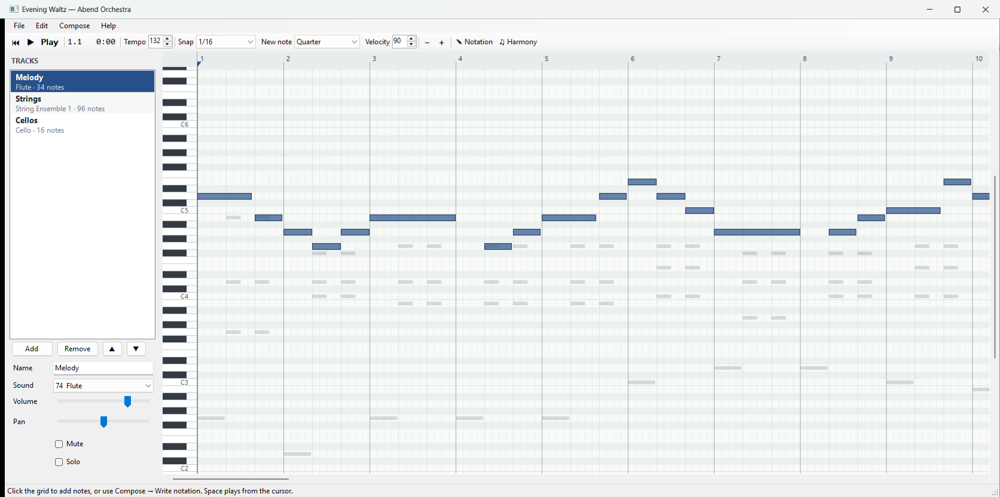

# Abend Orchestra

**Abend Orchestra** turns a plain-text score into a recorded orchestra. It's the tool behind [Abend Radio](https://abendradio.com), a 24/7 internet station where AI does everything.

Claude wrote every line of this code. The station director has never written any. He says what he wants in plain words and listens to the result.

## What it does

You write (or ask an AI to write) a **score script**: a small text file with a header, some tracks of notes, and chord blocks that play accompaniment patterns:

```
title: Evening Waltz
tempo: 132
meter: 3/4

track Melody | instrument: flute
\mp d5/2 b4/4 | (a4/4 g4/4 a4/4 | b4/2.) | ...

chords Strings | instrument: strings | voices: 3 | range: G3-B4 | pattern: 4: r c' c'
\p G/2. | D7 | G | G | ...
```

`abendc` checks it bar by bar (with line numbers an AI can fix), writes a MIDI file, and renders an MP3 with FluidSynth and ffmpeg:
- loudness matched;
- optionally played by a real sampled orchestra (the Sonatina Symphonic Orchestra), with natural playing: swells, legato and slight human timing.

On Windows there is also an editor window with a piano roll, for looking at a score, playing it and changing notes by hand:



## Let an AI write the music

[docs/AI-GUIDE.md](docs/AI-GUIDE.md) is the whole score format, written for AI models.
1. Paste it into any AI chat and describe the piece you want.
2. Save the answer as `song.abscore`.
3. Run `abendc song.abscore --check`.
4. Send any errors back to the AI.

This is how Abend Radio's composers work.

## Commands

```
abendc song.abscore                 check it and write song.mid
abendc song.abscore --check         only check
abendc song.abscore --lint          also give style hints
abendc --guide                      print the AI guide
abendc --version                    print the version
abendc render <folder or file> --out out [--library sonatina] [--expression] [--lufs -14] [--bass 5] ...
```

Abend Radio renders with `--lufs -14 --bass 5 --library sonatina --expression`.

## Examples

- `examples/Evening Waltz.abscore`: a 16-bar starter to copy and change (MIT).
- `examples/station/The Rabbit Rondo.abscore`: a full orchestral showpiece by the station's composer Livia Spirelli, a jig built on Fibonacci numbers.
  - It was generated by a small program, so it's spelled out note by note: a showpiece of what abendc can play, not a tutorial.
  - Licence: CC BY-NC-ND 4.0 (see below).

## Getting started (release download)

**Windows**

1. Unzip `abend-orchestra-<version>-windows.zip`.
2. Open the unzipped `abend-orchestra-<version>-windows` folder, then open PowerShell there (in File Explorer: File > Open Windows PowerShell, or right-click the folder > Open in Terminal).
3. Install ffmpeg, which renders the MP3s: `winget install --id Gyan.FFmpeg -e`. Then **close the terminal and open a new one** in the same folder, so ffmpeg is found.
4. Optional, for the orchestra: `powershell -ExecutionPolicy Bypass -File setup-sounds.ps1` (418 MB; it asks first).
5. Try it:
   ```
   .\abendc.exe "examples\Evening Waltz.abscore" --check
   .\abendc.exe render examples --out out                                   # default sounds
   .\abendc.exe render examples --out out --library sonatina --expression   # the orchestra (after step 4)
   ```

`AbendOrchestra.exe` is the editor window: File > Open example. Windows may warn that the program is from an unknown publisher (it isn't code-signed): choose "More info", then "Run anyway".

**Mac and Linux**

1. Unzip `abend-orchestra-<version>-portable.zip` and open a terminal in the unzipped folder.
2. Install the [.NET runtime](https://dotnet.microsoft.com/download) (version 8 or newer, for example .NET 10), FluidSynth and ffmpeg:
   - Mac: `brew install fluid-synth ffmpeg`;
   - Linux: `sudo apt install fluidsynth ffmpeg`.
3. Make the launcher runnable once: `chmod +x abendc`.
4. Optional, for the orchestra: `sh setup-sounds.sh` (418 MB; it asks first).
5. Try it:
   ```
   ./abendc "examples/Evening Waltz.abscore" --check
   ./abendc render examples --out out                                   # default sounds
   ./abendc render examples --out out --library sonatina --expression   # the orchestra (after step 4)
   ```

Rendering levels every piece to -14 LUFS, like music platforms. A very dynamic piece is gently narrowed so its quiet passages stay audible on the radio (the log then says "soft/loud range narrowed for radio"). To keep more of the contrast, add `--lra 30`.

## Sounds

The release download includes:
- the default sounds (GeneralUser GS);
- a sampled harpsichord, pipe organ and accordion;
- FluidSynth (on Windows).

The orchestra itself (the Sonatina Symphonic Orchestra, 418 MB) comes from its original source with the setup script (step 4 above). The script:
- shows what it will download and asks first;
- checks the file's SHA-256;
- puts it in `soundfonts/Sonatina` with its licence;
- tells you whether FluidSynth and ffmpeg are found.

On Windows, `setup-sounds.ps1 -InstallFfmpeg` also installs ffmpeg with winget; this accepts winget's package agreements for you.

abendc looks for FluidSynth, ffmpeg and the sounds in this order: `--tools`, the `ABEND_TOOLS` environment variable, the program's own folder (its `tools` and `soundfonts` folders), the folder you chose in the editor window, and, for the tools, your `PATH`.

## Building

With the [.NET SDK](https://dotnet.microsoft.com/download), version 8 or newer (Windows, Mac or Linux):

```
dotnet build src/abendc/abendc.csproj -c Release          # the command line
dotnet run --project tests/runner.csproj -c Release       # the tests
dotnet build src/editor/AbendOrchestra.csproj -c Release   # the editor window (Windows only)
```

You also need FluidSynth and ffmpeg for audio:
- Mac: `brew install fluid-synth ffmpeg`;
- Linux: `sudo apt install fluidsynth ffmpeg`;
- Windows: FluidSynth comes with the release download, and ffmpeg via `winget install --id Gyan.FFmpeg -e`.

On Windows without the SDK, `powershell -ExecutionPolicy Bypass -File build-windows.ps1` builds the same programs with the C# compiler that comes with Windows.

The same score gives the same MIDI on every system: the tests check it.

## About the code

Abend Orchestra was written by Claude in Claude Code sessions, directed by someone who isn't a programmer. It works, and it's tested: over 100 checks run on every build. It grew one feature at a time, whenever the station needed something new, rather than from a grand design, and you'll see that in places. Issues and contributions are welcome.

The first version was written by the Claude session that became Anselm Abend, the station's house composer, to play his first symphony, Per aspera. Another Claude session, the station's orchestra developer, has looked after it since.

## Licences

- **Code, documentation (including the AI guide) and Evening Waltz:** MIT, see [LICENSE](LICENSE).
- **Station example scores** (`examples/station/`): CC BY-NC-ND 4.0, © 2026 Abend Radio (abendradio.com), see [examples/station/LICENSE](examples/station/LICENSE).
- **Sounds and tools** (FluidSynth, ffmpeg, GeneralUser GS, Sonatina Symphonic Orchestra, VCSL, FreePats): their own licences, see [THIRD-PARTY-NOTICES.md](THIRD-PARTY-NOTICES.md).
